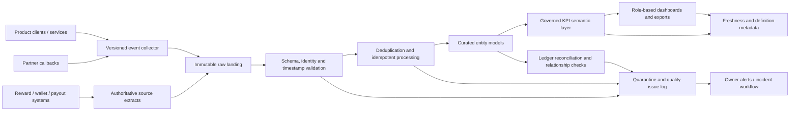

# VELOOP Task 01 — Proposed Analytics Pipeline Architecture

**Status:** design proposal only. No production ingestion, transformation, scheduler, warehouse or dashboard refresh is configured.

## Required operating controls

1. Version event contracts and define producer ownership.
2. Preserve raw payloads and received timestamps under approved retention.
3. Validate schema, type, requiredness, allowed values, identifiers, timezone and chronology.
4. Deduplicate using stable event IDs and idempotency keys; preserve duplicate evidence.
5. Model user, session, task attempt, reward ledger, wallet ledger, withdrawal state history, referral and feature events at explicit grains.
6. Centralize KPI formulas, eligibility rules, units, denominators, source lineage, owner and effective version.
7. Block or visibly mark dashboard publication when critical financial reconciliation or data-quality gates fail.
8. Monitor freshness, volume drift, schema drift, duplicates, orphans, failed loads and reconciliation exceptions.
9. Assign incident owners and document correction, rerun evidence and closure.
10. Apply least privilege, data minimisation, masking, retention and export controls after Security/Legal review.

## Suggested implementation order

- **P0:** approve canonical IDs, event envelope, status vocabularies, reward units, ledger references and KPI definitions.
- **P1:** source ingestion, raw landing, schema validation, deduplication and core entity models.
- **P2:** metric certification, reconciliation and quality gates.
- **P3:** dashboard UAT, role-based access, freshness SLAs, alerts and runbooks.
