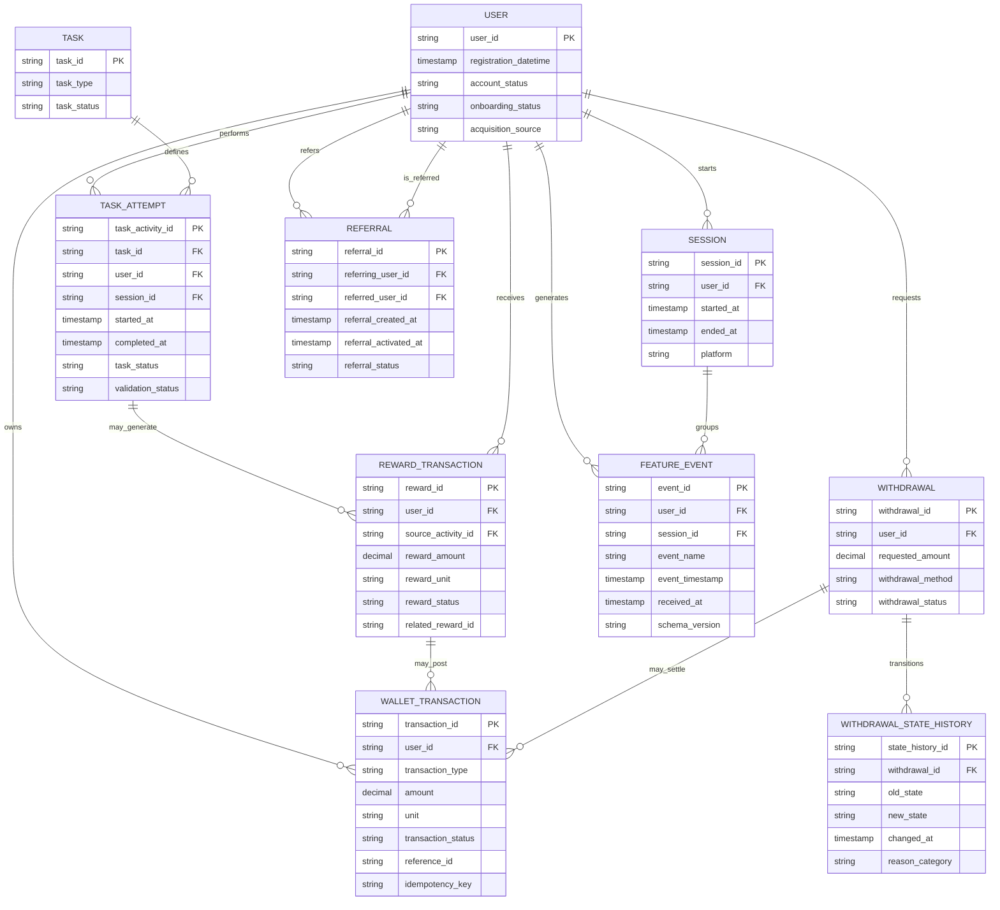

# VELOOP Task 01 — Proposed Logical ERD

**Status:** logical design proposal only. This is not a verified physical production schema. Entity names, keys, cardinalities and field constraints require Product/Engineering/Finance approval.

## Grain and integrity rules

- One row per user, session, task attempt, immutable reward transaction, wallet ledger movement, withdrawal, withdrawal state transition, referral and feature event.
- Keep `event_id`, `session_id`, `task_activity_id`, `reward_id`, `transaction_id`, `withdrawal_id` and `referral_id` distinct.
- Keep event occurrence time separate from received/ingested time.
- Reward reversals and corrections are new traceable transactions linked to the original; do not overwrite history.
- Amounts require explicit units and approved precision; do not aggregate unlike units.
- Every FK, uniqueness rule, status transition and nullable field requires owner-approved validation.
- No production schema or actual data integration is implied.
